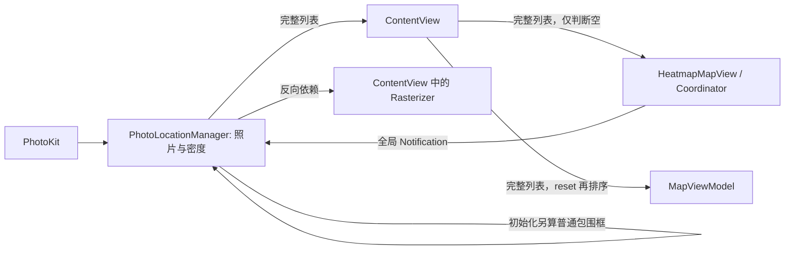
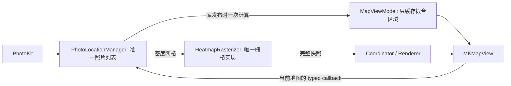

# 架构审查与功能接口清单

审查基线：`4509e0e`，2026-10-25。采用 Matt Pocock 的 codebase-design、improve-codebase-architecture、implement、tdd、code-review 实践。本报告既记录原问题，也记录本次修复后的真实接口。用户要求自动执行，按下列确定性问题直接修改，无新增框架、协议、替代渲染器或兼容分支。

## 产品约束

Apple Photos GPS 元数据 → Apple Maps 上的本地热力图。照片列表属于图库模块；地图控制只需要拟合区域；地图绘制只需要已完成的栅格快照。保留用户明确要求的热点选项和三种配色，它们是同一个算法的参数，不是三套实现。地图底图三种类型同样由 MapKit 的单一接口处理。

## 功能 → 接口 → 唯一实现

| 用户功能 | 真实接口 | 实现与状态归属 | 验证 |
|---|---|---|---|
| 读取 Photos 图像 GPS | `PhotoLocationManager.requestAuthorization()` | PhotoKit 请求权限；后台 `loadPhotoLocations` 枚举 image assets，仅取位置/标识/日期；manager 持有列表 | Release 编译；此前实库加载 15,640 个位置。新构建需另做启动验证 |
| 权限、加载进度、空库提示 | manager 的 authorizationStatus/isLoading/计数 → AuthorizationOverlay、StatusBarView | 一个图库加载流程；系统设置入口 | UI 编译；拒绝权限/空库分支静态核对 |
| 实际视口输入 | `HeatmapMapView.onRegionChange` → `updateMapRegion` | Coordinator 读取实际 MKMapView.region；manager 立即记录，只延迟 200ms 计算 | 原生快速缩放后 All Photos、回调隔离测试 |
| 密度计算 | `PhotoLocationManager.calculateHeatmapData` | 一份世界对齐 Mercator 网格；日期变更线取最近世界副本；每个快照预计算一个 Gaussian kernel | 地理锚定、重复照片贡献、跨网格缩放测试 |
| 位图生成 | `HeatmapRasterizer.makeImage` | Services/HeatmapRasterizer.swift；一次栅格化、共享 CIContext、每次独立滤镜；过期任务停止 | 直接编译生产文件；取消、颜色和尺度测试 |
| 拖动平滑 | `HeatmapData.canReuse`、Coordinator.updateHeatmap | 覆盖区域/分辨率/半径/连续尺度匹配时复用快照，renderer.draw 只绘制图像 | 120 步真实 MapKit 视口平移；同对象/同图像/峰值地理位置 |
| 缩放平滑 | Coordinator 的 transition 实现 | 0.22s smoothstep，最多两个 overlay，最多一个最新待显示快照；Reduce Motion 立即显示 | 中断、反向、最新帧、销毁、无交集跳转测试 |
| 快速连续/反向缩放 | `MapViewModel.zoomIn/zoomOut` | 单一 camera 实现；0.35s 输入窗口累积目标，实际地图回调始终有效 | 原生约束与延迟相机测试 |
| 初次显示全部、再次 All Photos | `updatePhotoLocations`、`resetView` | 一次计算并缓存拟合区域；首次非空自动拟合，后续库更新保留当前相机 | 单照片、跨日期线、同数量替换库、更新后 reset 测试 |
| World、快捷键 | `showWorld`；App View 菜单 → ContentView → 同一个 MapViewModel 方法 | 菜单与工具栏共用 camera 实现；⌘+/−、⌘0、⌘⇧0；⌘⇧H 打开热点面板 | 相机行为测试；菜单/快捷键静态核对 |
| 底图 | `MapViewModel.mapStyle` | didSet 唯一写入 MKMapView.mapType；新地图连接时同步初值 | 编译；原生 map style 检查 |
| Spread 10–100，默认 50 | `heatmapRadius` | 控件释放时提交；只在数值改变时重算密度 | 半径缓存测试；恢复默认路径核对 |
| Opacity 0–1，默认 .7 | HeatmapAppearance.opacity → renderer.updatePreview | 只改同步绘图快照 alpha，不重新累计或栅格化 | 连续预览、0 隐藏/恢复、同 renderer 测试 |
| Intensity .5–3、Smoothing 0–3 | `updateAppearance` | 网格可复用时只重新栅格化；默认 1 与 1.5 | 重着色、模糊尺度、无交叉淡化测试 |
| Classic / Ember / Ocean 与图例 | HeatmapPalette.stops/color、HeatmapGradientBar | 配色模型是地图和图例的唯一颜色来源 | 配色插值、预览、共享模型核对 |
| Restore Defaults | HeatmapOptionsView 的按钮 | 复原同一组参数，无第二套状态恢复实现 | 默认值测试、现有预览测试 |
| 安装、fork、提交推送 | Xcode scheme、用户 fork origin | 保留原工程/签名/只读 Photos entitlement | 全回归与 clean Release；提交和推送另记录最终结果 |

## 数据流：修复前与修复后

Swift Array 使用 copy-on-write：之前的赋值并不等于每层深拷贝。真实浪费是无用依赖、延长保留期、反复排序/计算和过期任务，而不是凭空宣称发生大量内存复制。密度网格保留在 HeatmapData 中供重着色，restyled 共享未修改的数组存储。

## 确认的问题与修复

| 问题 | 原因与影响 | 最小修复 | 结果 |
|---|---|---|---|
| 地图接收整份照片但只判断空 | UI 与绘制依赖图库原始数据 | 移除该参数；nil 快照唯一表示无热图 | 绘制接口缩小 |
| 相机视口通过全局、无类型通知传递 | 所有 manager 都接收事件；debounce 后才更新 region，设置可能按旧视口生成 | 每个地图一个 typed callback；立即更新 region，只 debounce 工作 | 回调局部化；最新视口可供设置读取 |
| 首次加载双重包围框算法 | manager 普通经纬度 min/max 与 map 的日期线算法不同；多一次密度/位图任务 | 删除 manager 初始包围框路径；以实际地图视口生成。每次库加载强制失效旧快照 | 一个拟合实现、一个视口来源 |
| 同数量库替换不更新相机缓存 | View 只监听 count | 监听真实列表的 publisher | All Photos 使用最新库 |
| All Photos 每次重复排序，camera 保留整份列表 | reset 直接 fitToShow(locations)，O(n log n) | 库更新时缓存 region，reset O(1) | 删除重复工作与数组保留 |
| mapStyle 双写 | didSet 和 Combine sink 做同一件事 | 删除 sink/cancellables | 一个写入实现 |
| Gaussian 权重逐照片重复 sqrt/exp | 同一快照的 kernel 与单张照片无关 | 每快照预计算，保持遍历和加法次序 | 超越函数调用次数从照片数×kernel 大小降为 kernel 大小 |
| 栅格逻辑放在 UI 文件，测试切割源代码 | manager 反向依赖 UI；移动注释能让 harness 失效 | 移动现有实现到一个生产文件；测试与 app 编译同一文件 | 一个实现，没有测试副本 |
| 过期栅格继续占用工作线程 | cancel 仅在照片循环/发布时检查 | 栅格逐列、blur 前和归一化逐列检查取消 | 尽早停止已过期 CPU 工作；正在执行的 CI 调用仍不可中断 |
| 每次创建 CIContext、相同 radius 也重算 | GPU 上下文初始化与无效写入 | 共享 CIContext；radius oldValue 判断 | 删除已确认的重复工作 |
| 未使用的派生接口 | contains、另一套 boundingBox、dateRange、currentZoomLevel、clusteringRadius、仅测试使用的 centerOn/fitToShow 没有生产消费者 | 删除 | 无新增协议或转发层 |

## 保留的必要复杂度与边界

- Coordinator 管地图快照交接，MapViewModel 管相机命令，manager 管图库和生成任务；没有为每个类增加 protocol/adapter。地图适配器是必要的 SwiftUI–AppKit 接口。
- camera 的请求区域与实际地图区域用于支持未连接地图时的命令和原生约束；pendingZoomRegion 用于输入合并，不能与实际区域混为一份状态。
- appearance 在 UI 中即时显示，manager 保存 worker 所需值快照，renderer 保存同步 image+opacity。这些值具有不同线程/交互用途，不通过删除快照来制造竞争。
- global Notification 目前仍用于 App 菜单命令，只有一个窗口命令接收入口；本次删除的是高频、携带实际视口数据的全局通知。多窗口焦点命令路由未在本次用户功能中要求。
- 图库目前只在授权/启动时读取，不实时监听 Photos 库变更；本次未新增未经要求的监控。
- 密度按当前栅格相对归一化，平移到未缓存区域可改变相对颜色。最终位图在网格量化边缘仍有小幅采样差异，现有可重复测试允许小于 10% 的扩散差异；不能宣称逐像素恒定。
- 未移除错误处理、权限状态或取消保护；它们对应真实系统行为，不是备用实现。未加入虚构的性能提升百分比。

## 验证记录

- 本次最终生产源在独立临时目录 `/private/tmp/GTPhotoDensityMap-architecture.0Kf21F` 验证：`bash Tests/run-all.sh` 退出 0；四组原生回归全部通过。随后只修改注释和文档。
- 新增覆盖：同数量替换库后 All Photos 使用新区域；typed callback 不广播给无关地图；已取消的设置预览停止栅格工作；重复照片按同一 kernel 累加；原生底图切换。
- 120 步原生对角/反向平移保留同一 overlay、快照和图像；热点投影误差最大 0.000064px。跨量化边缘的最终 alpha 扩散为 24.394→26.418px，差异约 8.3%，在既定小于 10% 的标准内。
- `xcodebuild ... -configuration Release ... clean build` 退出 0；`codesign --verify --deep --strict` 对构建产物和安装副本均通过。唯一警告为已有 AppIntents metadata extraction skipped。
- 已安装到 `/Applications/GTPhotoDensityMap.app`；可执行文件 SHA256 `c55fdce37a0068ecfd1d3c742a247ccdcaa8c1e2645803dc90085615acced6b8`。完整测试与构建日志在本地 `build/architecture-review/`（不提交机器日志）。
- Standards 与 Spec 独立审查均无剩余具体问题。审查指出的归一化取消检查文档差异已修正并重跑测试。
- 实际启动验证受阻：系统设置显示本应用已有 Photos Full Access，但 PhotoKit 的 `com.apple.photos.accessCallbacks` 等待 `_checkAuthStatusForPhotosAccessScope`，应用主线程空闲。刷新同范围授权与退出重启后仍等待。自动审批拒绝 `tccutil reset Photos com.gennarotangari.GTPhotoDensityMap`，要求针对重置旧记录的明确用户授权；已询问，尚未执行。故本轮**不宣称实库加载与交互验证完成**，也不将旧版本 15,640 照片加载证据算成本轮结果。
- 图库/生成调度尚无独立的无权限 manager 集成测试；本次验证依赖原生地图接口测试、真实计算/渲染测试与静态审查。没有为了测试增加生产 loader protocol、备用实现或仅测试使用的转发接口。
